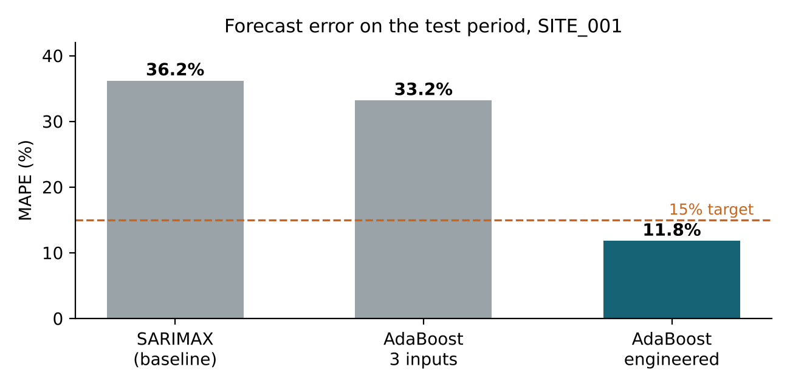
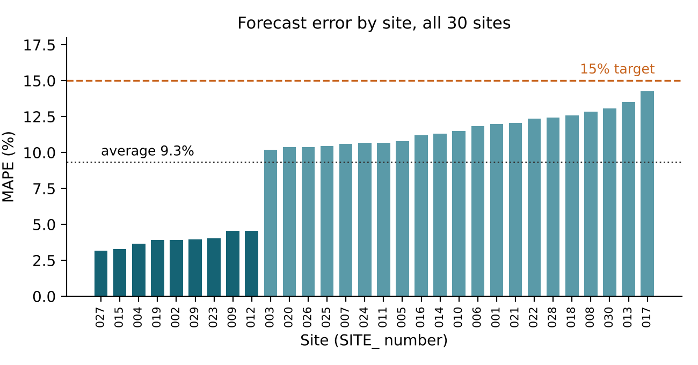
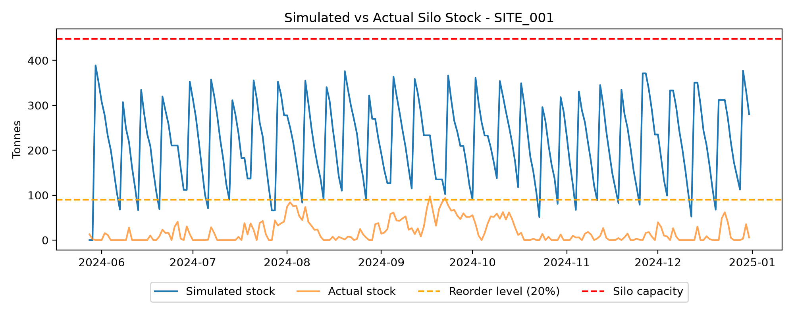
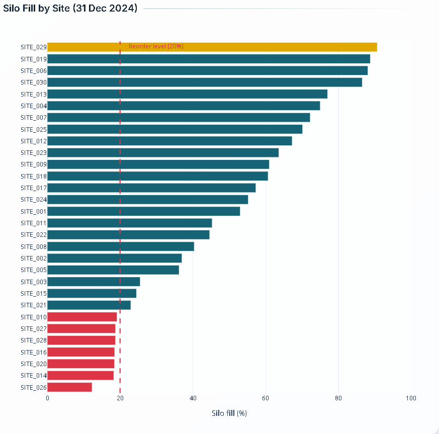
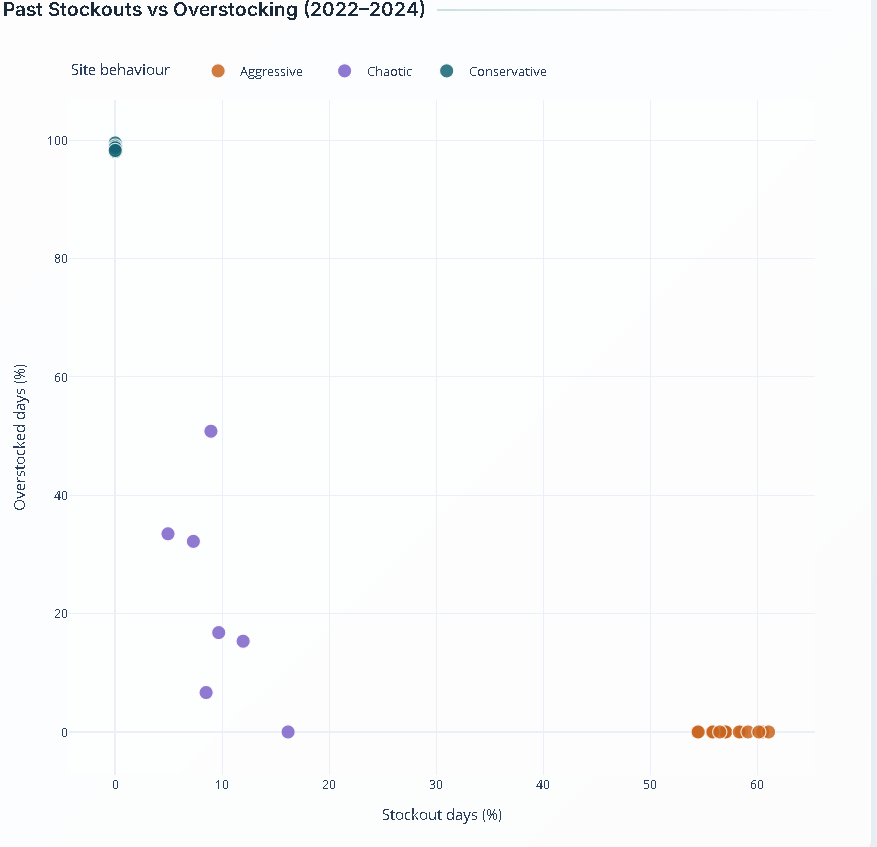

# MIG Cement Demand Forecasting and Inventory Optimisation

Forecasting daily cement demand across 30 construction sites and turning those forecasts into smarter ordering, so sites stop running out of cement while others sit on more than their silos can hold.

  

---

## Business problem

Midlands Infrastructure Group (MIG) runs around 30 construction sites, and cement availability decides whether concrete pours go ahead. Cement is planned with rolling four-week schedules and spreadsheets, which leads to:

- **Stockouts:** not enough cement for the planned pour on **29%** of site-days, leaving crews idle.
- **Overstocking:** more cement than the silo can hold on **35%** of site-days, tying up money and risking waste. This reached about **43%** in autumn 2024.
- **Reactive ordering:** near-daily, last-minute deliveries.

Both problems happen at the same time across the network: the issue is cement going to the wrong sites at the wrong times.

## Objectives

| Objective | Target |
|---|---|
| Forecast site-level cement demand | MAPE ≤ 15% |
| Improve construction readiness | Cement available for ≥ 98% of scheduled pours |
| Optimise inventory | +20% silo utilisation, −30% write-offs |
| Strengthen procurement planning | Forecast-driven reorder points |
| Improve operational visibility | Multi-page dashboard for planners and site managers |

## Tools

- **Data:** SQLite, SQL, pandas, NumPy
- **Analysis and charts:** Matplotlib, Seaborn, Plotly
- **Modelling:** statsmodels (SARIMAX), scikit-learn (AdaBoost)
- **Dashboard:** Plotly Dash, Dash Bootstrap Components
- **Environment:** Python, Jupyter, VS Code

## Project structure

```
mig-cement-demand-forecast/
├── dashboard/
│   └── app.py                         # Two-page Plotly Dash app
├── data/
│   ├── raw/                           # Source database (not included)
│   └── processed/                     # Outputs from the notebooks (not included)
├── notebooks/
│   ├── 01_sql_pipeline.ipynb          # Load and join data from SQLite
│   ├── 02_data_validation_kpi_analysis.ipynb   # Data checks, KPIs and EDA
│   ├── 03_modelling.ipynb             # SARIMAX baseline vs AdaBoost
│   ├── 04_feature_engineering_modelling.ipynb  # Engineered features and inventory simulation
│   └── 05_scaling.ipynb               # Model and simulation for all 30 sites
├── reports/                           # Charts, final report and presentation
│   ├── MIG_Cement_Final_Report.pdf
│   └── MIG_Cement_Presentation.pdf
├── src/
│   ├── data_loader.py                 # SQL query and data loading
│   ├── metrics.py                     # MAPE and RMSE
│   └── pipeline.py                    # Features, AdaBoost forecast and inventory simulation
├── Project_structure.py               # Creates the project folders
├── requirements.txt
└── README.md
```

## Methodology

1. **Extract:** joined daily site operations with site details from the SQLite database (32,880 rows: 30 sites, January 2022 to December 2024).
2. **Validate:** checked that opening stock + deliveries − consumption = closing stock. This held on **99.98%** of days.
3. **Explore:** flagged stockout, overstock, waste-risk, idle and disrupted days, and built KPIs by site, region and ordering behaviour.
4. **Engineer features:** lags, rolling averages (built from previous days only, to avoid data leakage), rain × pour, temperature × pour, inventory gap and inventory ratio.
5. **Forecast:** trained on the first 80% of days and tested on the last seven months. SARIMAX was the baseline and AdaBoost the main model.
6. **Simulate:** tested a forecast-based ordering rule day by day: reorder at 20% of silo capacity, refill to 80%, two-day lead time, and a 10% buffer on days with 10 mm or more of rain.
7. **Present:** built a two-page Plotly Dash dashboard.

## Key findings

- **Stockouts and overstocking coexist.** About a third of sites are overstocked on a typical day, while almost as many run short.
- **Ordering behaviour matters more than region.**

| Behaviour | Sites | Stockout days | Overstocked days |
|---|---|---|---|
| Aggressive | 14 | 57.5% | 0% |
| Chaotic | 7 | 9.6% | 22.2% |
| Conservative | 9 | 0% | 98.7% |

- **Demand follows the pour schedule.** Planned pour has a 0.78 correlation with actual use. Heavy rain cuts use to 80% of plan, and stockouts cut it to 61%.
- **There's no seasonal or weekly pattern.** Monthly use varies by only about 6%, so calendar-based forecasting doesn't help.

## Model evaluation

Test period: 28 May – 31 December 2024 (SITE_001).

| Model | MAPE | RMSE |
|---|---|---|
| SARIMAX (baseline) | 36.2% | 11.73 t |
| AdaBoost, 3 inputs | 33.2% | 9.73 t |
| **AdaBoost, engineered features** | **11.8%** | **4.04 t** |



Across **all 30 sites**, every site met the 15% target, with an **average MAPE of 9.3%** (range 3.2%–14.3%).

*The 30-site run used a slightly simpler set of rolling features, so these scores may be a little optimistic; the SITE_001 result above is the more cautious figure.*



The most important features were planned pour (0.38), inventory gap (0.34) and rainfall (0.15). Past consumption and calendar features added almost nothing.

## Inventory simulation (SITE_001)

| Measure | What happened | Forecast-based ordering |
|---|---|---|
| Stockout days | 106 | **1** |
| Deliveries | 218 | **29** |
| Average stock | 18.9 t (4% of silo) | 218.2 t (49% of silo) |



## Dashboard

The Plotly Dash app has two pages:

- **Network Overview (for planners):** KPIs for all 30 sites, silo fill with reorder alerts, past stockout vs overstock rates by behaviour, and an alerts table.
- **Site View (for site managers):** stock forecast against silo capacity, reorder triggers, and recommended order dates, quantities and rain buffers.





> The dashboard simulation uses planned, upgraded silo capacities (1,000–2,500 t per site).

## Recommendations

1. **Order from the forecast:** reorder when projected stock falls below the reorder level.
2. **Keep a safety stock at aggressive sites:** fewer, larger orders holding about a week of cement.
3. **Pause orders at conservative sites:** stop deliveries above silo capacity and move surplus to sites that run short.
4. **Match silos to demand:** prioritise upgrades at high-use sites.
5. **Review the dashboard weekly** and track stockouts, overstocking, deliveries and utilisation monthly.

## Installation

```bash
# 1. Clone the repository
git clone https://github.com/uzonnannorom-rgb/mig-cement-demand-forecast.git
cd mig-cement-demand-forecast

# 2. Create and activate a virtual environment
python -m venv .venv
.venv\Scripts\activate        # Windows
# source .venv/bin/activate   # macOS/Linux

# 3. Install the packages
pip install -r requirements.txt
```

**Data:** the source database isn't included in this repository. Place `MIG_Cement_Records.db` in `data/raw/`, then run the notebooks in order (01 to 05) to create the files in `data/processed/`.

**Run the dashboard:**

```bash
cd dashboard
python app.py
```

Then open http://127.0.0.1:8050 in your browser.

## Limitations and next steps

- The simulation assumes deliveries always arrive on time, and the detailed results come from SITE_001.
- The ordering rule can reorder while a delivery is still in transit.
- Forecasts combine all cement types, and write-offs couldn't be measured (no expiry records).
- Next steps: pilot at two aggressive sites, count in-transit deliveries, add delivery delays, forecast by cement type, and retrain monthly.

## Reports

- [Final report (PDF)](reports/MIG_Cement_Final_Report.pdf)
- [Presentation (PDF)](reports/MIG_Cement_Presentation.pdf)

## Author

**Uchechukwu Uzonna Nnorom**
